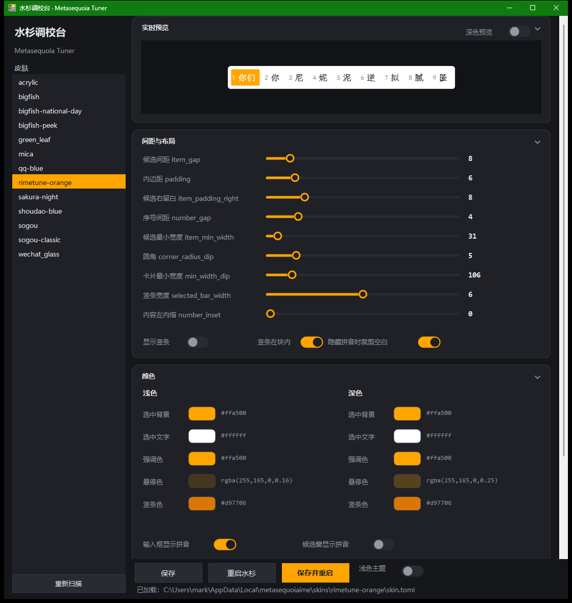
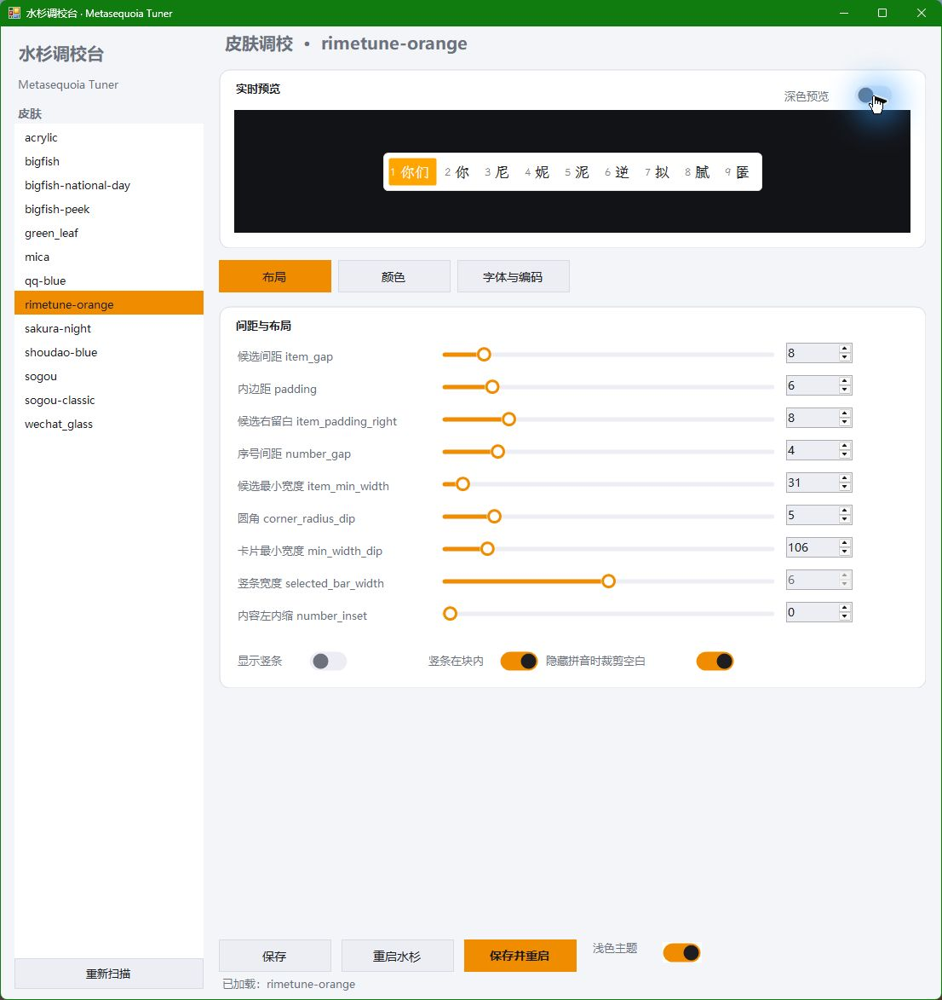

# 水杉调校台 · Metasequoia Tuner

[](https://github.com/doublemarkpro/metasequoia-tuner/actions/workflows/build.yml)
[](https://github.com/doublemarkpro/metasequoia-tuner/releases)


一个给 [水杉输入法](https://msime.app/)（Metasequoia IME）用的 Windows 小工具：**可视化调候选窗皮肤、字体和编码显示，改完一键重启输入法**。

不用再手写 `skin.toml` / `config.toml`，也不用每次改完去任务管理器里杀进程。



## 功能

### 皮肤参数（写入 `skin.toml`）

- **间距与布局**：候选间距 `item_gap`、内边距 `padding`、候选右留白、序号间距、候选最小宽度、卡片圆角、卡片最小宽度、内容左内缩 `number_inset`
- **选中竖条**：宽度 `selected_bar_width`、是否显示 `show_selected_bar`、贴内/骑边 `selected_bar_inside`
- **颜色**：选中背景 / 选中文字 / 强调色 / 悬停色 / 竖条色，浅色深色各一套，点色块直接调色板取色
- **隐藏拼音时裁剪空白**：`trim_hidden_preedit_gap`，解决编码区隐藏后候选窗上方留一条空白的问题

### 字体（写入 `config.toml`）

- **候选窗主字体** `english_font`（水杉设置里叫「候选窗主字体」，默认 `Segoe UI`）
- **中文回退字体** `font`
- **字号** `font_size`
- 字体下拉自动列出系统已装字体，预览实时用所选字体渲染

### 编码（拼音）显示

- **候选窗显示拼音** `candidate_window_preedit_style`（`pinyin` / `empty`）
- **输入框显示拼音** `tsf_preedit_style`（`raw` / `empty`）

### 其它

- **实时预览**：9 个候选项的模拟候选窗，改任何参数立刻重绘
- **深色 / 浅色主题**：工具自身两套配色，可切换
- **卡片折叠**：标题栏点击折叠/展开
- **记住上次状态**：主题、折叠状态、所选皮肤、窗口大小
- **一键重启**：`保存并重启` 会提权结束 `MetasequoiaImeServer` 并重新拉起，改完立刻生效



## 快速开始

1. 下载 [Releases](../../releases) 里的 `MetasequoiaTuner.exe`
2. 双击运行（单文件，依赖系统自带的 .NET Framework 4.8，无需安装）
3. 左侧选皮肤 → 右边调参数 → 点「保存并重启」

> 「重启水杉」会弹 UAC：`MetasequoiaImeServer` 以管理员权限运行，不提权杀不掉。

## 自己编译

需要系统自带的 .NET Framework 4.x（Windows 10/11 默认自带）：

```powershell
.\build.ps1
# 产物：dist\MetasequoiaTuner.exe
```

没有任何第三方依赖，`csc.exe` 直接编译，不需要装 Visual Studio。

## 配置文件位置

| 内容 | 路径 |
|---|---|
| 皮肤 | `%LOCALAPPDATA%\metasequoiaime\skins\<皮肤名>\skin.toml` |
| 全局外观（字体、编码） | `%LOCALAPPDATA%\metasequoiaime\config.toml` |
| 本工具自身设置 | `%LOCALAPPDATA%\Programs\MetasequoiaTuner\settings.ini` |

## 说明

- 本工具只是**改配置文件 + 重启进程**的图形界面，不修改水杉本体，也不注入任何东西
- 保存前建议备份 `metasequoiaime` 目录；改坏了把对应键删掉即可恢复
- 「保存并重启」会同时写入 `config.toml`，如果水杉设置窗口开着，建议先关掉，避免互相覆盖

## 致谢

- [水杉输入法 Metasequoia IME](https://github.com/metasequoiaime) —— 皮肤与配置格式的灵感来源
- 皮肤字段含义参考 `msime-windows` 源码中 `candidate_skin_catalog.cpp` / `CandidateList.cpp`

## License

[MIT](LICENSE)
